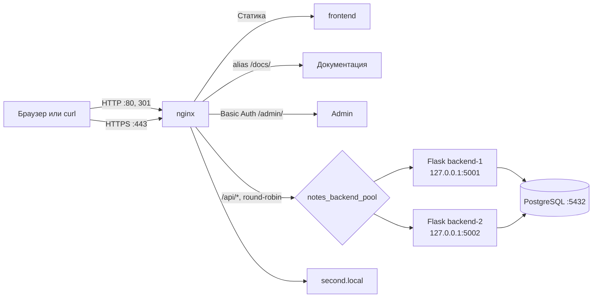

# Лабораторная работа № 1

## nginx перед Notes Service: один вход, два backend-а и несколько способов всё сломать

- **Участники:** `bLamixs`, `garar1337`, `sashamakkaveev-spec`, `L4mi2107`
- **Дата:** 4 ноября 2026 г.
- **Репозиторий:** [bLamixs/4ikago-balls-](https://github.com/bLamixs/4ikago-balls-)
- **Pull request:** [№ 1 — лабораторная работа про nginx](https://github.com/bLamixs/4ikago-balls-/pull/1)
- **Проверка в Linux:** [успешный прогон GitHub Actions](https://github.com/bLamixs/4ikago-balls-/actions/runs/41837650827)

> Основу работы начал Леха и Стас. Мы продолжили её вместе: свели приложение, nginx-конфигурацию, скрипты и инструкцию в одну работающую схему. По дороге выяснилось, что иногда самый сложный балансировщик - это просто несколько файлов, которые называют одну и ту же вещь по-разному.

## Задание

Настроить nginx как единую точку входа для Notes Service. nginx принимает HTTP на порту 80 и перенаправляет запросы на HTTPS, самостоятельно раздаёт фронтенд, а API проксирует к двум экземплярам Flask.

Дополнительно требовалось настроить round-robin, переживать остановку одного backend-а, раздавать `/docs/` через `alias`, защищать `/admin/` через Basic Authentication, ограничивать частоту запросов с ответом `429`, обслуживать второй виртуальный хост `second.local` и показывать свою страницу 404.

## Архитектура



В пуле nginx используется round-robin. API ограничен значением `5r/s` с `burst=2 nodelay`; при превышении лимита nginx возвращает `429`. Для upstream заданы таймауты и повторная попытка при недоступности одного экземпляра.

## Ход работы

### 1. Подготовили приложение и базу

Flask-приложение использует PostgreSQL, таблицу `notes` и переменные `DB_HOST`, `DB_PORT`, `DB_NAME`, `DB_USER`, `DB_PASSWORD`. Два процесса запускаются на портах 5001 и 5002.

Чтобы видеть, какой экземпляр обслужил запрос, приложение читает `INSTANCE_ID`. Endpoint `/api/whoami` возвращает JSON с `backend_id` и заголовок `X-Backend-ID`.

```json
{"backend_id":"backend-1"}
```

или:

```json
{"backend_id":"backend-2"}
```

### 2. Подняли nginx и HTTPS

Для локальной лабораторной используется самоподписанный сертификат с именами `notes.local` и `second.local`. В `/etc/hosts` оба имени указывают на `127.0.0.1`. Сертификат не является доверенным для браузера, поэтому в локальных командах `curl` используется `-k`.

HTTP-запросы на `notes.local` и `second.local` получают `301` на HTTPS. Неизвестный Host попадает в catch-all сервер nginx и отклоняется ответом `444` без тела.

### 3. Настроили виртуальные хосты и маршруты

- `notes.local` отдаёт `frontend/` напрямую через nginx.
- `/api/` проксируется в `notes_backend_pool`.
- `/docs/` обслуживается через `alias`.
- `/admin/` требует Basic Authentication.
- `second.local` отдаёт отдельную страницу из `other-site/`.
- для отсутствующих страниц настроена пользовательская 404.

Проверка конфигурации выполняется до запуска сервиса:

```bash
sudo nginx -t
```

### 4. Разобрали первые ошибки

Первый вариант `check.sh` проверял `/api/whoami`, которого приложение ещё не имело. В соседних файлах расходились `BACKEND_ID` и `INSTANCE_ID`, а проверка искала `X-Backend-ID`, хотя Flask отправлял `X-Backend-Instance`.

Нашлись и менее заметные препятствия: скрипт запускался под именем `run_backend.sh`, а инструкции ссылались на `run_backends.sh`; конфигурация nginx лежала не по пути из README; скрипта остановки backend-ов не было. Файл зависимостей назывался `requirments.txt`, хотя команды установки ожидали `requirements.txt`. Несколько ссылок GitHub оказались вставлены прямо в команды `curl`, из-за чего копируемые команды были невалидны.

Мы согласовали endpoint, переменную окружения и заголовок, исправили пути, переименовали файл зависимостей и добавили `stop_backends.sh`. Ещё один тестовый сюрприз: слишком частые запросы для проверки round-robin сами попадали под rate limit. Проверка теперь делает один запрос за раз с небольшим интервалом, а проверку `429` запускает параллельно.

Наконец, первый Linux-прогон показал, что `trap` в `check.sh` затирал код ошибки при завершении. Из-за этого GitHub Actions показывал зелёный статус даже при строках `FAIL`. Мы поправили обработчик завершения: теперь ошибка теста сохраняет ненулевой код выхода, а workflow завершается неуспешно, если проверка действительно падает.

## Настройка окружения

Ниже - воспроизводимая последовательность для Ubuntu/Debian. В GitHub Actions она была выполнена на временном Ubuntu runner с PostgreSQL 16.

### 1. Установка пакетов

```bash
sudo apt update
sudo apt install -y nginx openssl apache2-utils curl python3 python3-venv postgresql-client
```

### 2. Создание базы

Создать пользователя и базу можно по инструкции Лабы 0. В проверочном прогоне использовались значения:

```text
DB_HOST=127.0.0.1
DB_PORT=5432
DB_NAME=notes_db
DB_USER=notes_user
DB_PASSWORD=notes_password
```

Таблица создаётся из файла проекта:

```bash
psql -h 127.0.0.1 -U notes_user -d notes_db -f backend/init.sql
```

### 3. Имена и сертификат

Добавить локальные имена:

```bash
printf '127.0.0.1 notes.local second.local\n' | sudo tee -a /etc/hosts
```

Создать сертификат и ключ:

```bash
sudo install -d -m 0755 /etc/nginx/lab1-certs
sudo openssl req -x509 -nodes -days 365 -newkey rsa:2048 \
  -keyout /etc/nginx/lab1-certs/notes.local.key \
  -out /etc/nginx/lab1-certs/notes.local.crt \
  -subj "/C=RU/ST=Local/L=Local/O=Notes Lab/OU=Lab 1/CN=notes.local" \
  -addext "subjectAltName=DNS:notes.local,DNS:second.local,IP:127.0.0.1"
sudo chmod 600 /etc/nginx/lab1-certs/notes.local.key
sudo chmod 644 /etc/nginx/lab1-certs/notes.local.crt
```

### 4. Basic Authentication

Для учебного окружения создаётся тестовая учётная запись `admin`:

```bash
sudo install -d -m 0755 /etc/nginx/lab1-auth
sudo htpasswd -c /etc/nginx/lab1-auth/notes.htpasswd admin
sudo chmod 640 /etc/nginx/lab1-auth/notes.htpasswd
sudo chown root:www-data /etc/nginx/lab1-auth/notes.htpasswd
```

Автоматическая проверка использует пароль `lab1admin`. Он предназначен только для лабораторной среды.

### 5. Установка nginx-конфигурации

```bash
sudo cp nginx/snippets/proxy_params_lab1.conf /etc/nginx/snippets/proxy_params_lab1.conf
sudo cp nginx/sites-available/lab1.conf /etc/nginx/sites-available/lab1.conf
sudo rm -f /etc/nginx/sites-enabled/default
sudo ln -sfn /etc/nginx/sites-available/lab1.conf /etc/nginx/sites-enabled/lab1.conf
sudo nginx -t
sudo systemctl reload nginx
```

### 6. Python и два Flask-инстанса

Файл зависимостей находится в `backend/requirements.txt`:

```bash
python3 -m venv backend/.venv
backend/.venv/bin/pip install -r backend/requirements.txt
chmod +x scripts/run_backend.sh scripts/stop_backends.sh scripts/check.sh
```

Настроить переменные базы и Python, затем запустить оба экземпляра:

```bash
export PYTHON_BIN="$PWD/backend/.venv/bin/python"
export DB_HOST=127.0.0.1 DB_PORT=5432 DB_NAME=notes_db
export DB_USER=notes_user DB_PASSWORD=notes_password
./scripts/run_backend.sh
```

## Результаты проверки

Полный прогон выполнен в GitHub Actions на Ubuntu 26.04.1 с nginx 1.28.3 и PostgreSQL 16. Workflow создал локальный сертификат и пользователя Basic Auth, запустил два Flask-процесса, выполнил `nginx -t`, затем `scripts/check.sh`.

**Итог автоматической проверки: 12 PASS, 0 FAIL.** [Полный запуск и логи](https://github.com/bLamixs/4ikago-balls-/actions/runs/41837650827).

| Проверка | Полученный результат |
|---|---|
| Конфигурация nginx | `nginx -t` завершился успешно |
| HTTPS health check | `200 OK` |
| HTTP → HTTPS | `301 Moved Permanently`, `Location: https://notes.local/` |
| Round-robin | В серии запросов получены `backend-1` и `backend-2` |
| `/admin/` без пароля | `401 Unauthorized` |
| `/admin/` с `admin:lab1admin` | `200 OK` |
| Rate limit | Среди параллельных запросов получен `429 Too Many Requests` |
| Главная страница | nginx отдал страницу «Мои заметки» |
| `/docs/` | nginx отдал документацию из `alias` |
| `second.local` | Отдан отдельный сайт `Second Local Project` |
| Неизвестный Host | Отклонён catch-all виртуальным хостом |
| Кастомная 404 | `404 Not Found` с текстом «404 — Страница не найдена» |
| Failover | После остановки `backend-1` пять запросов подряд получили `200 OK` от `backend-2` |

Примеры фактических ответов из прогона:

```text
HTTP/1.1 301 Moved Permanently
Location: https://notes.local/
```

```text
HTTP/1.1 401 Unauthorized
HTTP/1.1 200 OK
```

```text
HTTP/1.1 429 Too Many Requests
```

После остановки первого backend-а:

```text
HTTP/1.1 200 OK
X-Backend-ID: backend-2
{"backend_id":"backend-2"}
```

## Вывод

nginx принимает входящий трафик, перенаправляет HTTP на HTTPS, раздаёт статические страницы и балансирует запросы между двумя Flask-инстансами. Basic Authentication, rate limiting, виртуальные хосты, `alias`, собственная 404 и отказ одного backend-а проверены в Linux-прогоне.

Самая важная часть этой лабораторной оказалась на стыке компонентов: один endpoint должен одинаково называться в Flask, скриптах и README. После выравнивания имён и исправления обработчика `trap` автоматическая проверка стала отражать реальный результат, а не просто зелёный статус. Исходники и полный журнал прогона доступны в [PR № 1](https://github.com/bLamixs/4ikago-balls-/pull/1) и [GitHub Actions](https://github.com/bLamixs/4ikago-balls-/actions/runs/41837650827).
